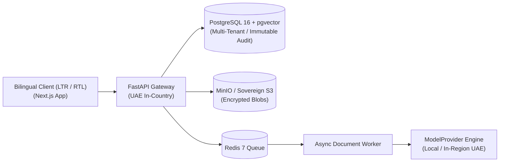

# Multi-Tenant Document Intelligence SaaS (UAE Market)

A multi-tenant Document Intelligence SaaS platform purpose-built for UAE sovereign compliance (Banking KYC, Trade & Logistics, Insurance Claims).

---

## Non-Negotiable UAE Sovereign Compliance Guarantees

1. **Strict In-Country Data Boundary (`STRICT_LOCAL_ONLY=true`)**:
   - Zero outbound requests to non-sovereign external LLM/OCR APIs (OpenAI, Anthropic, Gemini US).
   - In-region cloud (Azure UAE North / AWS UAE me-central-1) or in-cluster air-gapped models only.
2. **Zero Foreign Telemetry or Log Leaks**:
   - No external third-party APM/telemetry that ships PII or document text abroad.
3. **Multi-Tenant Query-Layer Isolation**:
   - Every table is stamped with `tenant_id`. All queries enforce tenant isolation via authentication context and row-level checks.
4. **Immutable Audit Trail**:
   - Tamper-proof logging for all authentication attempts, user creations, schema adjustments, document actions, and deletions with PII masking.
5. **Configurable Document Types**:
   - Non-hardcoded schemas for Emirates ID, UAE Trade License, and Commercial Invoices with Arabic and English bilingual fields.

---

## Architecture Overview

Detailed architectural blueprints and threat matrices are located in [docs/ARCHITECTURE.md](docs/ARCHITECTURE.md).



---

## Directory Structure

```
docsmvp/
├── docker-compose.yml              # Local sovereign stack (Postgres + pgvector, Redis, MinIO, Backend)
├── .env.example                    # UAE compliance environment defaults
├── README.md                       # Project overview & running instructions
├── docs/
│   └── ARCHITECTURE.md             # System architecture & cross-border risk analysis
├── sample_documents/               # Synthetic sample fixtures (zero real PII)
│   ├── synthetic_emirates_id_front.svg
│   ├── synthetic_trade_license.svg
│   └── metadata.json
└── backend/
    ├── Dockerfile                  # Air-gapped container definition
    ├── requirements.txt            # Python dependencies
    ├── app/
    │   ├── api/
    │   │   ├── deps.py             # Tenant context & RBAC permission dependencies
    │   │   └── v1/
    │   │       ├── auth.py         # JWT login & profile
    │   │       ├── tenants.py      # Multi-tenant onboarding & settings
    │   │       ├── users.py        # RBAC user management & API key generation
    │   │       ├── document_types.py # Configurable schema definitions
    │   │       ├── audit.py        # Immutable audit log query API
    │   │       └── router.py
    │   ├── core/
    │   │   ├── config.py           # UAE data sovereignty guardrails
    │   │   ├── database.py         # Async SQLAlchemy 2.0 engine & sessions
    │   │   ├── security.py         # Passwords, tokens, API keys & PII masking
    │   │   └── rbac.py             # Roles (Admin, Reviewer, Viewer, API Client)
    │   ├── models/                 # Domain entities (Tenant, User, Document, AuditLog)
    │   ├── schemas/                # Pydantic v2 schemas
    │   └── services/
    │       ├── audit_service.py    # Immutable audit logger
    │       └── model_engine/       # Swappable model provider interface & adapters
    └── tests/                      # Automated test suite (12 passing tests)
        ├── conftest.py
        ├── test_tenant_isolation.py
        ├── test_auth_rbac.py
        ├── test_audit_logs.py
        └── test_uae_compliance.py
```

---

## Quickstart

### 1. Environment & Dependencies

```bash
# Set up virtual environment
python -m venv .venv
source .venv/bin/activate  # On Windows: .venv\Scripts\activate

# Install dependencies
pip install -r backend/requirements.txt
```

### 2. Run Test Suite

```bash
pytest backend/tests -v
```

### 3. Run Backend Locally

```bash
uvicorn backend.app.main:app --reload --port 8000
```
Open API docs: [http://localhost:8000/docs](http://localhost:8000/docs)  
Health & Sovereignty check: [http://localhost:8000/health](http://localhost:8000/health)
