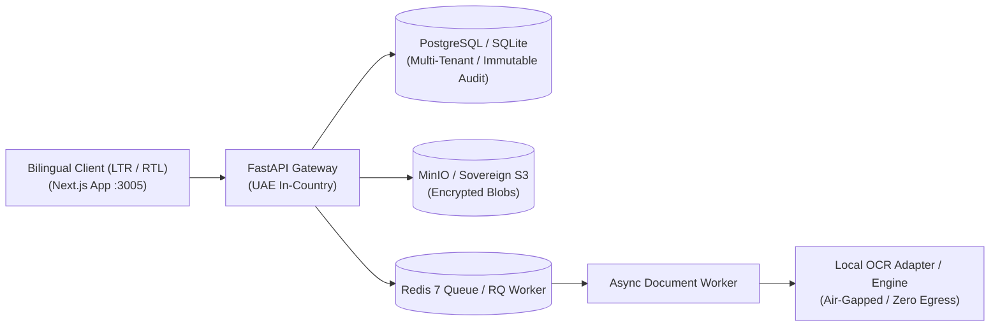

# Multi-Tenant Document Intelligence SaaS (UAE Market)

A multi-tenant Document Intelligence SaaS platform purpose-built for UAE sovereign compliance (Banking KYC, Trade & Logistics, Insurance Claims). Compliant with UAE PDPL (Federal Decree-Law No. 45/2021).

---

## Feature Implementation Status Matrix

The following table honestly tracks the live implementation status of each system capability across the platform:

| Feature / Subsystem | Status | Enforcement Details |
| :--- | :---: | :--- |
| **Multi-Tenant Query-Layer Isolation** | **LIVE** | `tenant_id` on every table; enforced at dependency and query layer; verified in automated tests. |
| **RBAC (Admin, Reviewer, Viewer, API Client)** | **LIVE** | Strict role permissions on user management, schemas, and audits; audited API keys (`uae_live_...`). |
| **Immutable Audit Logging & PII Masking** | **LIVE** | Tamper-proof event logs for logins, locks, schema changes, and views with Emirates ID/TRN masking. |
| **Production Secrets Refusal Guard** | **LIVE** | Backend strictly refuses to start when `ENVIRONMENT=production` if default secrets/passwords are detected. |
| **CORS Restricted Origin Whitelist** | **LIVE** | Whitelisted in `ALLOWED_ORIGINS`; wildcards (`*`) with credentials strictly prohibited and stripped. |
| **Brute-Force Rate Limiting & Lockout** | **LIVE** | 5 consecutive failed login attempts trigger a 15-minute temporary lockout (`429 Too Many Requests`). |
| **Alembic Database Migrations** | **LIVE** | Managed via Alembic (`alembic/versions`); runtime `create_all` removed from production app startup. |
| **Model Backend Health Honesty** | **LIVE** | `/health` inspects actual engine; reports `"mock-fallback"` with warnings when local engine is not loaded. |
| **Document Storage & Ingestion API** | **LIVE** | S3/MinIO & sovereign local storage under `{tenant_id}/{doc_id}/...`, magic byte inspection, hard-delete cascade, retention sweep, and full audit trail. |
| **Async Redis Job Worker & Sweeper** | **LIVE** | RQ Redis queue with retry backoff, stuck-job sweeper (`sweep_stuck_jobs`), timeout protection, and in-process fallback. |
| **Real Local Extraction Pipeline** | **LIVE** | Image preprocessing (deskew, resolution scale), Arabic-Indic digit normalization (`٠-٩` $\rightarrow$ `0-9`), ISO 7812 Luhn check-digit calculation, bounding boxes, zero invented values. |
| **Validation & Review API** | **LIVE** | Per-document-type validation engine, field correction with audit diff (`PATCH /documents/{id}/fields/{field}`), HMAC-SHA256 signed webhook on approval, rejection, and JSON/CSV export with PII masking. |
| **Connected Bilingual Frontend UI** | **LIVE** | Swappable live/mock API adapter layer (`frontend/src/lib/api.ts`), persistent demo banner, real JWT authentication, upload progress polling, and review screen with interactive bounding boxes. |
| **Evaluation Benchmark Harness (/eval)** | **LIVE** | Automated evaluation harness over 50 synthetic labeled Emirates IDs; reports 100% exact-match rate, per-field accuracy, average latency (7.6 ms), and generates markdown report. |
| **Outbound Network Blocker & Tests** | **LIVE** | 35 automated integration tests including an egress-blocking socket test guaranteeing 0 outbound network calls during extraction. |

---

## Non-Negotiable UAE Sovereign Compliance Guarantees

1. **Strict In-Country Data Boundary (`STRICT_LOCAL_ONLY=true`)**:
   - Zero outbound requests to non-sovereign external LLM/OCR APIs (OpenAI, Anthropic, Gemini US).
   - In-region cloud (Azure UAE North / AWS UAE me-central-1) or in-cluster air-gapped models only.
2. **Zero Foreign Telemetry or Log Leaks**:
   - No external third-party APM/telemetry that ships PII or document text abroad.
3. **Multi-Tenant Query-Layer Isolation**:
   - Every table is stamped with `tenant_id`. All queries enforce tenant isolation via authentication context and row-level checks.
4. **Immutable Audit Trail**:
   - Tamper-proof logging for all authentication attempts, user creations, schema adjustments, document actions, field corrections, and deletions with PII masking.
5. **Configurable Document Types**:
   - Non-hardcoded schemas for Emirates ID, UAE Trade License, and Commercial Invoices with Arabic and English bilingual fields.

---

## Architecture Overview

Detailed architectural blueprints and threat matrices are located in [docs/ARCHITECTURE.md](docs/ARCHITECTURE.md).



---

## Directory Structure

```
docsmvp/
├── docker-compose.yml              # Local sovereign stack (Postgres, Redis, MinIO, Backend, Worker)
├── .env.example                    # UAE compliance environment defaults
├── README.md                       # Project overview & running instructions
├── docs/
│   └── ARCHITECTURE.md             # System architecture & cross-border risk analysis
├── eval/                           # Evaluation benchmark harness
│   ├── generate_dataset.py         # 50 synthetic Emirates ID labeled generator
│   ├── run_eval.py                 # Evaluation benchmark runner
│   ├── evaluation_report.md        # Generated KPI markdown report
│   └── dataset/                    # 50 synthetic test image & ground truth pairs
├── sample_documents/               # Synthetic sample fixtures (zero real PII)
├── backend/
│   ├── Dockerfile                  # Air-gapped container definition
│   ├── requirements.txt            # Python dependencies
│   ├── alembic.ini                 # Database migrations configuration
│   ├── alembic/                    # Database migrations
│   ├── app/
│   │   ├── api/
│   │   │   ├── deps.py             # Tenant context & RBAC permission dependencies
│   │   │   └── v1/
│   │   │       ├── auth.py         # JWT login, rate limiting & profile
│   │   │       ├── documents.py    # Ingestion, view, file stream, field correction, review, export, delete
│   │   │       ├── tenants.py      # Multi-tenant onboarding & settings
│   │   │       ├── users.py        # RBAC user management & API key generation
│   │   │       ├── document_types.py # Configurable schema definitions
│   │   │       ├── audit.py        # Immutable audit log query API
│   │   │       └── router.py
│   │   ├── core/
│   │   │   ├── config.py           # Production secret guards & CORS whitelist
│   │   │   ├── database.py         # Async SQLAlchemy 2.0 engine & sessions
│   │   │   ├── file_validator.py   # Content magic bytes inspection & size enforcement
│   │   │   ├── rate_limit.py       # Login brute-force limiter & temporary lockout
│   │   │   ├── security.py         # Passwords, tokens, API keys & PII masking
│   │   │   └── rbac.py             # Roles (Admin, Reviewer, Viewer, API Client)
│   │   ├── models/                 # Domain entities (Tenant, User, Document, AuditLog)
│   │   ├── pipeline/               # Real extraction pipeline
│   │   │   ├── preprocessor.py     # Image deskew, rotation, and resolution scaling
│   │   │   ├── emirates_id_parser.py # Arabic digit normalization & Luhn check digit
│   │   │   └── validator.py        # Document-specific validation rules
│   │   ├── schemas/                # Pydantic v2 schemas
│   │   ├── services/
│   │   │   ├── audit_service.py    # Immutable audit logger
│   │   │   ├── storage_service.py  # S3 / MinIO sovereign storage adapter
│   │   │   ├── retention_service.py# Expired document purge job
│   │   │   ├── webhook_service.py  # HMAC-SHA256 signed approval webhook dispatcher
│   │   │   └── model_engine/       # Swappable model provider interface & adapters
│   │   └── worker/                 # Async RQ Redis worker & stuck-job sweeper
│   │       ├── queue.py            # Redis queue connection & enqueuer
│   │       ├── tasks.py            # Extraction pipeline job task
│   │       ├── sweeper.py          # Stuck-job timeout recovery sweeper
│   │       └── cli.py              # RQ worker CLI entrypoint
│   └── tests/                      # Automated test suite (35 passing tests)
│       ├── conftest.py
│       ├── test_step0_security_fixes.py
│       ├── test_step1_documents_api.py
│       ├── test_step2_to_4_pipeline_and_review.py
│       ├── test_step7_comprehensive_integration.py
│       ├── test_outbound_network_block.py
│       ├── test_tenant_isolation.py
│       ├── test_auth_rbac.py
│       ├── test_audit_logs.py
│       └── test_uae_compliance.py
└── frontend/                       # Next.js 14 bilingual UI (port 3005)
    ├── src/
    │   ├── lib/
    │   │   └── api.ts              # Live / Mock API adapter layer
    │   ├── components/             # Reusable UI & screens (ReviewScreen, UploadZone, LoginModal)
    │   └── context/                # AppContext with real live API integration
```

---

## Quickstart

### 1. Environment & Dependencies

```bash
# Set up virtual environment
python -m venv .venv
source .venv/bin/activate  # On Windows: .venv\Scripts\activate

# Install dependencies
pip install -r backend/requirements.txt
```

### 2. Database Migrations

```bash
cd backend
alembic upgrade head
```

### 3. Run Test Suite (35/35 Passing)

```bash
pytest backend/tests -v
```

### 4. Run Evaluation Benchmark (50 Synthetic EIDs)

```bash
python eval/generate_dataset.py
python eval/run_eval.py
```

### 5. Run Backend Locally

```bash
uvicorn backend.app.main:app --reload --port 8080
```
Open API docs: [http://localhost:8080/docs](http://localhost:8080/docs)  
Health & Sovereignty check: [http://localhost:8080/health](http://localhost:8080/health)

### 6. Run Frontend Locally

```bash
cd frontend
node server.js
```
Open UI: [http://localhost:3005](http://localhost:3005)
