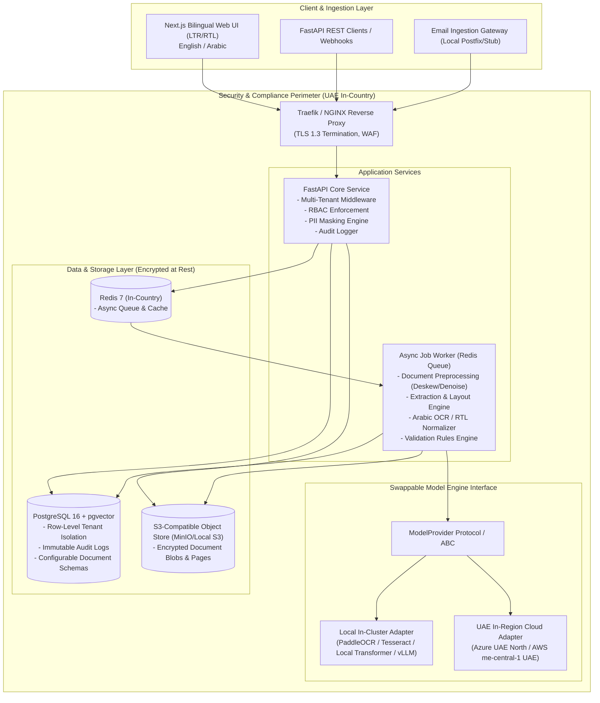

# UAE Document Intelligence SaaS Platform
## Phase 1: System Architecture & Compliance Specification

---

### 1. Executive Summary & Regulatory Context

This platform is a multi-tenant Document Intelligence SaaS tailored for the United Arab Emirates (UAE) market, specifically serving Banking/KYC, Insurance, Logistics, and Corporate Services.

#### Compliance Non-Negotiables (UAE Data Sovereignty):
1. **Federal Decree-Law No. 45 of 2021 on Personal Data Protection (PDPL)**:
   - Personal data processing, storage, backups, and derived intelligence must remain in-country.
   - Cross-border transfers require an adequate level of protection or explicit statutory exception.
2. **Central Bank of the UAE (CBUAE) Consumer Protection & Outsourcing Regulations**:
   - Banking KYC data, Emirates IDs, and financial records must be isolated by tenant and held in UAE-based infrastructure (e.g., Azure UAE North / Central, AWS me-central-1 UAE, or on-premise private clouds).
3. **Cross-Border Leakage Prevention**:
   - Default setting: `STRICT_LOCAL_ONLY = true`.
   - Zero external cloud OCR/LLM API calls by default.
   - All fonts, assets, and dependencies are bundled locally (no external CDNs).
   - Zero foreign SaaS telemetry/analytics (no external Datadog, Sentry, or Google Analytics sending document payloads).

---

### 2. High-Level System Architecture



---

### 3. Cross-Border Risk Assessment & Mitigation Matrix

| Potential Risk Vector | Risk Level | Compliance Threat | Architectural Mitigation |
| :--- | :--- | :--- | :--- |
| **Model Provider Calls** (OpenAI, Gemini US, Anthropic) | **CRITICAL** | Data transmitted outside UAE borders in violation of PDPL. | `ModelProvider` abstraction with strict policy guard: only local open models or UAE in-region private endpoints allowed. Hard-blocked via environment validation. |
| **Telemetry / Log Shipping** (Sentry, Datadog cloud) | **HIGH** | Error stack traces may leak Emirates ID, names, addresses abroad. | Self-hosted OpenTelemetry and local audit log table. Document contents never logged in raw application logs. |
| **Frontend CDN Assets** (Google Fonts, unpkg) | **MEDIUM** | Browser requests leak client IP addresses and user metadata abroad. | All fonts (Cairo, Tajawal, Inter) and assets are bundled in the frontend container. |
| **Third-Party Email / SMS APIs** (SendGrid, Twilio) | **HIGH** | Notification payloads contain customer names and document references. | Local UAE SMTP gateway or sovereign SMS aggregator. |

---

### 4. Multi-Tenant Isolation Model

1. **Logical Separation with Query-Layer Enforcement**:
   - Every single persistent table contains `tenant_id: UUID`.
   - The FastAPI dependency `get_tenant_context()` extracts the tenant identity from authenticated JWT claims or API key metadata.
   - Database queries automatically apply `.filter(Model.tenant_id == tenant_context.id)`.
   - Helper base query wrapper prevents accidental cross-tenant leaks.
2. **PostgreSQL Row-Level Security (RLS) Ready**:
   - Connection sessions set `SET LOCAL app.current_tenant_id = '...'` before query execution, enabling PostgreSQL kernel-level row filtering.
3. **Storage Isolation**:
   - Object storage paths are strictly prefixed: `/{tenant_id}/documents/{document_id}/{filename}`.

---

### 5. Role-Based Access Control (RBAC) Matrix

| Permission / Action | Admin | Reviewer | Viewer | API Client |
| :--- | :---: | :---: | :---: | :---: |
| **Manage Tenant & Settings** | :white_check_mark: | :x: | :x: | :x: |
| **Manage Users & Roles** | :white_check_mark: | :x: | :x: | :x: |
| **Manage Document Schemas** | :white_check_mark: | :x: | :x: | :x: |
| **Upload Documents** | :white_check_mark: | :white_check_mark: | :x: | :white_check_mark: |
| **View Documents & Previews** | :white_check_mark: | :white_check_mark: | :white_check_mark: | :white_check_mark: |
| **Correct & Approve Fields** | :white_check_mark: | :white_check_mark: | :x: | :x: |
| **Export Structured Data (CSV/JSON)** | :white_check_mark: | :white_check_mark: | :white_check_mark: | :white_check_mark: |
| **View Audit Logs** | :white_check_mark: | :x: | :x: | :x: |
| **Configure Retention & Hard Delete**| :white_check_mark: | :x: | :x: | :x: |

---

### 6. Immutable Audit Log Architecture

- Every read, write, export, correction, and deletion triggers an audit event.
- Stored in `audit_logs` table.
- Contains:
  - `tenant_id`: Tenant context
  - `actor_id`: User UUID or API key identifier
  - `actor_role`: Role at execution time
  - `action`: `DOCUMENT_VIEW`, `DOCUMENT_UPLOAD`, `FIELD_CORRECT`, `DOCUMENT_APPROVE`, `DOCUMENT_EXPORT`, `DOCUMENT_DELETE`, `TENANT_CONFIG_CHANGE`
  - `entity_type`: e.g., `document`, `extracted_field`, `tenant`
  - `entity_id`: Target entity UUID
  - `ip_address`: Client remote IP
  - `user_agent`: Client user agent
  - `payload_diff`: JSON representation of previous vs updated state (with PII masking applied where appropriate)
  - `created_at`: UTC timestamp (immutable, no update allowed)

---

### 7. Swappable Model Layer Specification

```python
class ModelProvider(Protocol):
    """Abstract interface for UAE-compliant Document Intelligence model backends."""
    async def extract_layout(self, image_bytes: bytes) -> LayoutResult: ...
    async def classify_document(self, text_or_image: bytes) -> ClassificationResult: ...
    async def extract_fields(self, image_bytes: bytes, schema: dict) -> ExtractionResult: ...
```

Adapters implemented:
1. `LocalModelAdapter`: Air-gapped, runs in-cluster (e.g. PaddleOCR / Tesseract / LayoutLM / local vLLM).
2. `UAEInRegionCloudAdapter`: Connects strictly to verified UAE data-center endpoints (Azure UAE North, AWS UAE me-central-1) via private endpoints.
3. `MockTestAdapter`: Deterministic synthetic tests for Emirates ID and Trade Licenses without GPU requirements.
